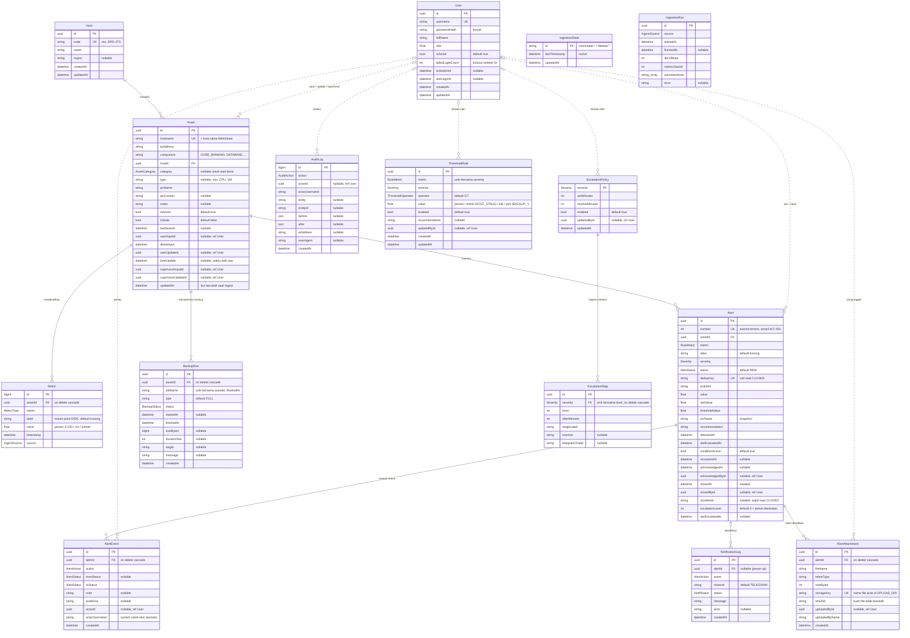
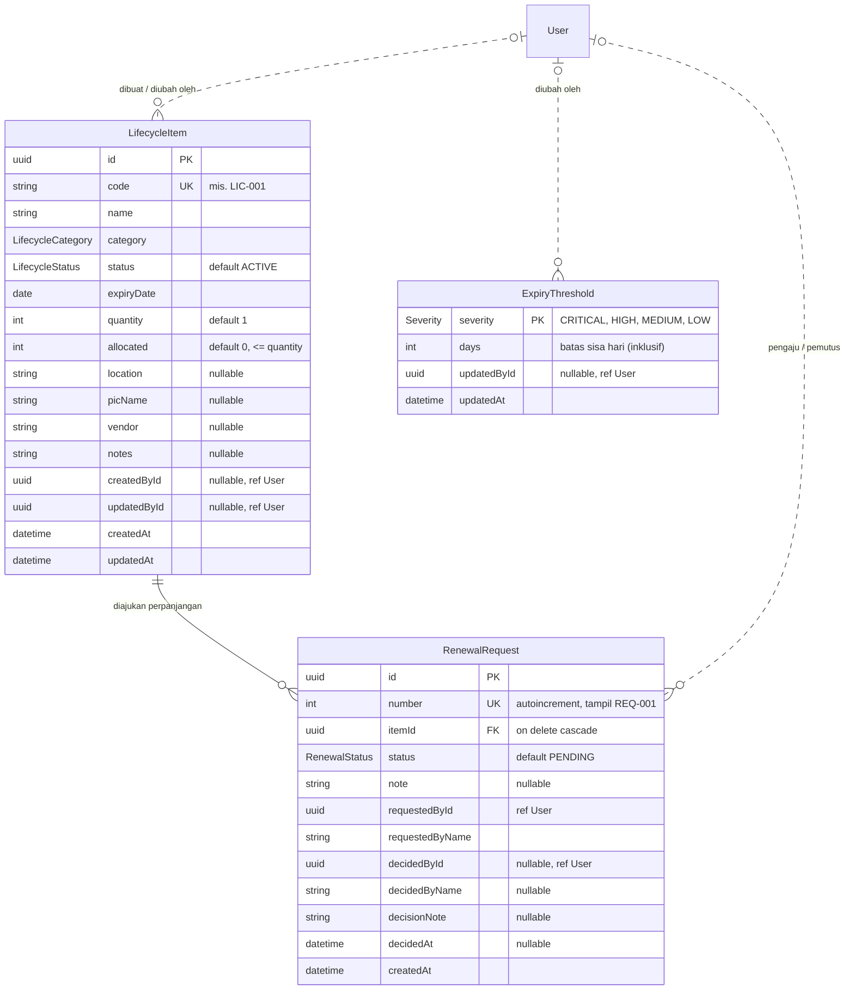

# ERD SYNRA

Disusun dari `prisma/schema.prisma` sampai migrasi `20261113080000_expiry_thresholds`
(`init`, `alert_condition_active`, `host_supervisor_asset_audit`, `lifecycle`, `backup_escalation`,
`alert_attachments`, `expiry_thresholds`). Garis putus-putus = referensi logis tanpa foreign key
(id pelaku disimpan sebagai riwayat, tetap valid walau user dinonaktifkan).

## Monitoring dan alert

## Siklus hidup (lifecycle)

`ExpiryThreshold` berdiri sendiri: berisi batas sisa hari per level yang dipakai untuk menghitung
`expiryLevel` setiap `LifecycleItem` (bukan relasi FK). Default saat migrasi: CRITICAL 30, HIGH 90,
MEDIUM 180, LOW 365.

## Enum

| Enum | Nilai |
|---|---|
| `Role` | ADMIN, SUPERVISOR, OPERATOR, MANAGEMENT, AUDITOR |
| `Severity` | INFO, LOW, MEDIUM, HIGH, CRITICAL |
| `MetricType` | CPU, MEMORY, DISK, UPTIME, LOG_ERROR_COUNT |
| `RuleMetric` | CPU, MEMORY, DISK, HOST_STALE, BACKUP_FAILED, BACKUP_AGE |
| `ThresholdOperator` | GT, GTE |
| `IngestSource` | ELASTICSEARCH, CSV |
| `AssetCategory` | HARDWARE, SOFTWARE |
| `NotifStatus` | SENT, FAILED, SKIPPED |
| `AlertStatus` | NEW, ACKNOWLEDGED, IN_PROGRESS, PENDING_REVIEW, CLOSED (alur berurutan; PENDING_REVIEW bisa kembali ke IN_PROGRESS) |
| `AlertAction` | CREATED, ACKNOWLEDGED, STARTED, SUBMITTED_REVIEW, RETURNED, CLOSED, SEVERITY_RAISED, ESCALATED |
| `AuditAction` | LOGIN_SUCCESS, LOGIN_FAILED, ACCOUNT_LOCKED, PASSWORD_CHANGE, THRESHOLD_CREATE, THRESHOLD_UPDATE, THRESHOLD_DELETE, ALERT_STATUS_CHANGE, ALERT_EVALUATE, ASSET_CREATE, ASSET_UPDATE, ASSET_DELETE, HOST_CREATE, HOST_UPDATE, HOST_DELETE, REPORT_EXPORT, METRIC_IMPORT, USER_CREATE, USER_UPDATE, USER_UNLOCK, USER_RESET_PASSWORD, LIFECYCLE_CREATE, LIFECYCLE_UPDATE, LIFECYCLE_DELETE, RENEWAL_REQUEST, RENEWAL_DECIDE, ESCALATION_UPDATE, ALERT_ATTACHMENT_UPLOAD (perubahan `ExpiryThreshold` dicatat sebagai THRESHOLD_UPDATE) |
| `BackupStatus` | SUCCESS, FAILED |
| `LifecycleCategory` | OS, LICENSE, CERTIFICATE, WARRANTY, CONTRACT |
| `LifecycleStatus` | ACTIVE, RENEWED, TERMINATED, INACTIVE |
| `RenewalStatus` | PENDING, APPROVED, REJECTED |

## Aturan integritas

| Aturan | Implementasi |
|---|---|
| Satu metrik per aset/metrik/mount/waktu (ingest idempoten) | `UNIQUE (assetId, metric, label, timestamp)` pada `Metric` |
| Tidak ada alert ganda selama alert sebelumnya belum CLOSED | `Alert.dedupKey` unik, berisi `assetId:metric:label`, dikosongkan saat CLOSED |
| Satu level per metrik dan severity | `UNIQUE (metric, severity)` pada `ThresholdRule` |
| Audit tidak bisa diubah atau dihapus | Trigger `BEFORE UPDATE OR DELETE` dan `BEFORE TRUNCATE` pada `AuditLog` |
| Host tidak bisa dihapus selama punya aset | FK `Asset.hostId` (RESTRICT) + validasi service |
| Supervisor pada aset harus user aktif ber-role SUPERVISOR | Validasi service; `null` bila tidak dipilih dan pengisinya bukan supervisor |
| Metrik ikut terhapus bila aset dihapus | FK `Metric.assetId` ON DELETE CASCADE |
| Riwayat alert ikut terhapus bila alert dihapus | FK `AlertEvent.alertId` ON DELETE CASCADE |
| Lampiran bukti tidak bisa dihapus lewat aplikasi | Tidak ada endpoint hapus; ikut terhapus hanya bila alert dihapus (CASCADE) |
| Satu hasil backup per aset/job/waktu selesai (ingest idempoten) | `UNIQUE (assetId, jobName, finishedAt)` pada `BackupRun` |
| Satu tingkat eskalasi per severity dan level | `UNIQUE (severity, level)` pada `EscalationStep` |
| Satu batas hari per level urgensi | `severity` sebagai PK pada `ExpiryThreshold` |
| Batas hari naik berurutan CRITICAL < HIGH < MEDIUM < LOW, 0–3650 | Validasi service (`validateExpiryThresholds`) |
| Kode item siklus hidup unik per kategori (LIC-001, CRT-001, ...) | `UNIQUE (code)` pada `LifecycleItem` |
| Terpakai tidak melebihi kuota | Validasi service (`allocated <= quantity`) |
| Satu pengajuan perpanjangan menunggu per item | Validasi service |
| Pengajuan ikut terhapus bila item dihapus | FK `RenewalRequest.itemId` ON DELETE CASCADE |
| Tidak ada data nasabah | Tidak ada tabel/kolom untuk isi log atau transaksi; Filebeat hanya disimpan sebagai jumlah error |
