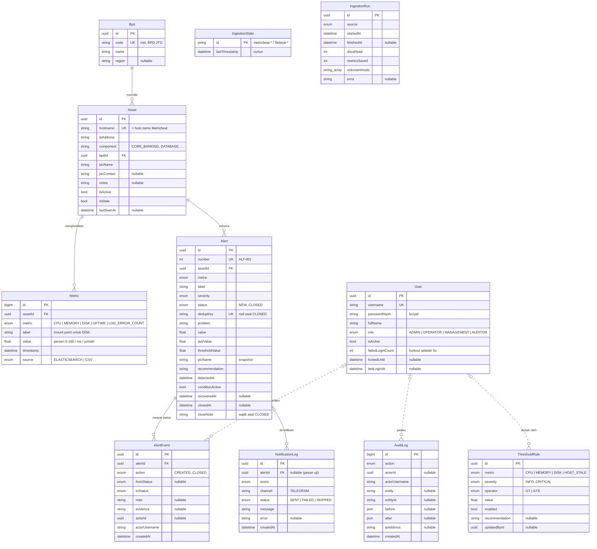

# ERD SYNRA

Disusun dari `prisma/schema.prisma` (migrasi `init` + `alert_condition_active`).
Garis putus-putus = referensi logis tanpa foreign key (id pelaku disimpan sebagai riwayat,
tetap valid walau user dinonaktifkan).

## Aturan integritas

| Aturan | Implementasi |
|---|---|
| Satu metrik per aset/metrik/mount/waktu (ingest idempoten) | `UNIQUE (assetId, metric, label, timestamp)` pada `Metric` |
| Tidak ada alert ganda selama alert sebelumnya belum CLOSED | `Alert.dedupKey` unik, berisi `assetId:metric:label`, dikosongkan saat CLOSED |
| Satu level per metrik dan severity | `UNIQUE (metric, severity)` pada `ThresholdRule` |
| Audit tidak bisa diubah atau dihapus | Trigger `BEFORE UPDATE OR DELETE` dan `BEFORE TRUNCATE` pada `AuditLog` |
| BPD tidak bisa dihapus selama punya aset | FK `Asset.bpdId` (RESTRICT) + validasi service |
| Metrik ikut terhapus bila aset dihapus | FK `Metric.assetId` ON DELETE CASCADE |
| Tidak ada data nasabah | Tidak ada tabel/kolom untuk isi log atau transaksi; Filebeat hanya disimpan sebagai jumlah error |
